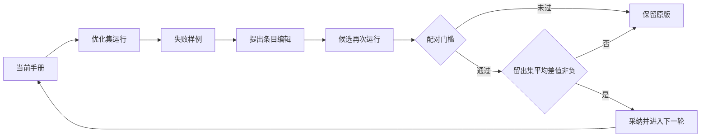

# 代码地图

| 文件 | 职责 | 阅读重点 |
|---|---|---|
| [tasks.py](../tasks.py) | 五类合成题、标准答案和输出解析 | 格式错误会影响分数；生成题不代表真实业务分布 |
| [harness_loop.py](../harness_loop.py) | 候选生成、优化集门槛、留出集筛选、最终 test | `paired_gate`、`apply_edit`、`main` 的采纳条件 |
| [binpack_eval.py](../binpack_eval.py) | 物品生成、在线装箱、归一化评分 | `make_instances`、`pack`、`score` |
| [evolve_code.py](../evolve_code.py) | 程序库、父代采样、生成与评估 | `unsafe_reason` 是过滤；`evaluate` 不是安全沙箱 |
| [common.py](../common.py) | 显式端点、模型调用、并发、日志 | 不发现本地凭据；只使用读者配置的线路 |
| [verify_evidence.py](../verify_evidence.py) | 无 API 的证据一致性与装箱复算 | 不把归档 JSON 当成完整轨迹审计 |
| [tests/test_offline.py](../tests/test_offline.py) | 核心行为检查 | 数据划分、配对门槛、编辑、过滤和默认拒绝执行 |

## 实验 A 的信息流

最后再用独立 test 比较 H0 与最终版本。留出集被用于选择，不应称它为完全未参与选择的最终验收集。
